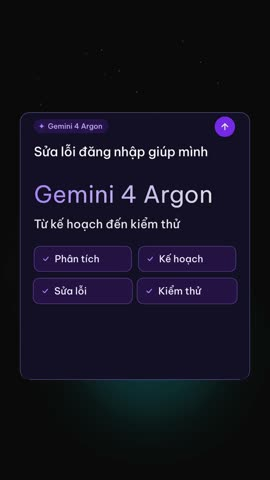
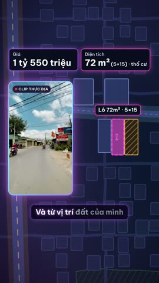

# opus-video

**Agent skill dựng video tiếng Việt từ một brief tới file MP4 giao khách.** Bạn nói chủ đề; agent dựng 3 hướng hình ảnh để bạn chọn, viết kịch bản, tạo giọng, dựng, kiểm tra rồi xuất bản giao 16:9, 9:16 hoặc cả hai. Mỗi bước có cổng kiểm tra chặn lại khi chưa đạt.

[](https://github.com/abm-dungtq/opus-video/releases/tag/v1.1.0)
[](LICENSE)


Chạy trên **Claude Code, OpenAI Codex, Google Antigravity (app và CLI)** và mọi agent đọc được thư mục skill có `SKILL.md`.

[Video demo](#video-demo) · [Có gì mới](#có-gì-mới) · [Cách hoạt động](#cách-hoạt-động) · [Cài đặt](#1-cài-đặt-nhanh-khuyên-dùng) · [Dùng](#6-dùng) · [Script](#7-script) · [Xử lý sự cố](#10-xử-lý-sự-cố)

## Video demo

Các video dưới đây do opus-video dựng. Bấm vào ảnh để mở file MP4 trong [bản release `demo-videos`](https://github.com/abm-dungtq/opus-video/releases/tag/demo-videos).

<table>
  <tr>
    <td align="center" valign="top" width="33%">
      <a href="https://github.com/abm-dungtq/opus-video/releases/download/demo-videos/gemini-argon-9x16.mp4"></a><br>
      <b>Gemini 4 Argon</b><br>9:16 · 15 giây<br>
      <sub>Theo quy trình mới: chọn 1 trong 3 styleframe (hướng A2, câu lệnh thành sản phẩm chạy thật), duyệt animatic hai vòng.</sub>
    </td>
    <td align="center" valign="top" width="33%">
      <a href="https://github.com/abm-dungtq/opus-video/releases/download/demo-videos/abm-intro-9x16.mp4"></a><br>
      <b>Giới thiệu ABM</b><br>9:16 · 30 giây<br>
      <sub>Bản dọc của video giới thiệu doanh nghiệp, dựng song song với bản 16:9.</sub>
    </td>
    <td align="center" valign="top" width="33%">
      <a href="https://github.com/abm-dungtq/opus-video/releases/download/demo-videos/bds-lo-72m2-9x16.mp4"></a><br>
      <b>Tin đăng lô đất 72 m²</b><br>9:16 · 60 giây · bản Zalo 720p<br>
      <sub>Clip người dùng quay chạy trong khung PiP trên nền bản đồ, phụ đề bám từng chữ.</sub>
    </td>
  </tr>
  <tr>
    <td align="center" valign="top" colspan="2">
      <a href="https://github.com/abm-dungtq/opus-video/releases/download/demo-videos/viet-pro-intro-16x9.mp4"></a><br>
      <b>Giới thiệu Viết Pro</b><br>16:9 · 60 giây<br>
      <sub>Video giới thiệu skill <a href="https://github.com/abm-dungtq/viet-pro-codex">viet-pro</a> cho người mới.</sub>
    </td>
    <td align="center" valign="top">
      <a href="https://github.com/abm-dungtq/opus-video/releases/download/demo-videos/abm-intro-16x9.mp4"></a><br>
      <b>Giới thiệu ABM</b><br>16:9 · 30 giây
    </td>
  </tr>
</table>

## Có gì mới

### v1.1.0 (2026-10-14): ba cổng cho chuyển động

Ba lỗi trước đây lọt qua mọi cổng kiểm tra: tiếng SFX vang lệch khỏi khoảnh khắc trên hình, chữ biến mất trước khi người xem đọc kịp, và mỗi lần sửa phải render lại cả video mà không ghi lại đã sửa gì. Bản này thêm một cổng cho mỗi lỗi. Ý tưởng lấy từ tài liệu *Motion Engineering with Opus 5.5* của beamnxw (MIT); ngưỡng nào cũng có nguồn.

**1. Tiếng khớp hình (`sfx-sync.mjs`)**

- `PLAN.md` của dự án sáng tạo có thêm bảng `## Sự kiện`: lúc nào trên hình xảy ra gì và tiếng nào đi kèm (ví dụ `6.5 | nhấn nút Gửi | click.mp3`). Cổng plan chặn khi thiếu bảng; dự án không có SFX gắn sự kiện ghi một dòng `không có SFX gắn sự kiện`.
- Nhiều file SFX mở đầu bằng một đoạn im lặng, nên `data-start` chỉ là lúc file bắt đầu chứ chưa phải lúc nghe thấy tiếng. Script đo đoạn im lặng đó bằng ffmpeg, lấy ngưỡng theo đỉnh của chính file (đỉnh − 20 dB) để file nhỏ tiếng không bị coi là im lặng cả bài.
- Độ lệch được so với cửa sổ của ITU-R BT.1359-1: từ −45 đến +125 ms là PASS, tới −90 / +185 ms là WARN, ngoài nữa là FAIL. Mỗi sự kiện ra một dòng, ví dụ `PASS SYNC 6.5s nhấn nút Gửi ← click.mp3 lệch +30 ms (đầu file im 30 ms)`.
- `--fix` in giá trị `data-start` đúng để dán vào HTML, không tự sửa file. Cổng final tự chạy bước này và chặn tiếng lệch quá ngưỡng.

**2. Chữ đủ lâu để đọc**

- `check-preflight` đếm số từ của chữ trên hình (phần trong ngoặc kép ở cột Hình của `## Cảnh`) và in WARN khi chữ rời đi trước `số từ / 2,5 + 0,5 giây`, tối thiểu 1 giây. Tốc độ 2,5 từ/giây lấy từ viet-pro; 0,5 giây để mắt tìm tới chữ là giả định, sẽ chỉnh khi đo thêm dự án.
- Chữ ở lại sang beat sau thì ghi `(giữ đến 9.5s)` hoặc `(giữ đến hết)` trong ô Hình, cổng sẽ đo tới mốc đó.
- Cổng này chỉ cảnh báo, không chặn.

**3. Sửa theo vòng (`REVISIONS.md`)**

- Khi bạn góp ý, agent ghi mỗi chỗ sửa thành một mục 4 trường: **Vị trí** (giây trên timeline gốc), **Lỗi thấy**, **Đổi**, **Giữ nguyên** (các mốc không được động tới). Tối đa 5 mục một vòng; nhiều hơn thì agent hỏi mục nào để vòng sau. Mẫu ở `references/revisions.md`.
- Mỗi mục được kiểm bằng `hyperframes snapshot --at` đúng những giây đó, không render lại cả video. Hết vòng mới render lại animatic một lần để bạn duyệt.
- Cổng final cảnh báo khi một vòng quá 5 mục hoặc một mục thiếu trường.

Dự án cũ (BRIEF không có `direction:` và `brief_version: 2`) không bị chặn thêm: với chúng, cả ba cổng chỉ in WARN.

### v1.0.0 (2026-10-14): chọn hình trước, dữ liệu thật

Bản trước dựng ra video kiểu trình chiếu: vài thẻ tiêu đề trượt lên rồi mờ đi. Bản này đổi thứ tự làm việc: chọn hình trước, viết lời sau, và mọi bước đều được đo bằng máy.

- **Chọn hướng bằng mắt.** `make-pitch.mjs` dựng 3 styleframe khoảng 3 giây từ chính chủ đề của bạn, theo 3 trong 8 hướng đạo diễn có trong HyperFrames. Bạn chọn một, đổi từ khoá nếu muốn. Styleframe được chọn thành cảnh mở đầu.
- **Lời đi theo hình.** Kịch bản viết sau khi đã chọn hướng và không được vượt `word_budget` của hướng đó. Vượt thì cổng viet-pro chặn (`VOICE_OVER_BUDGET`).
- **Dựng theo công thức thật.** `recipe-pack.mjs` gom đúng các blueprint, rule và kiểu nối cảnh mà `PLAN.md` nêu vào `build/RECIPES.md`. Cổng plan chặn cách nối cảnh bằng mờ dần.
- **Duyệt chuyển động, không duyệt ảnh tĩnh.** `make-demo.mjs --animatic` render clip nháp 540p để bạn xem trước khi render bản cuối. Sửa file dựng sau khi đã duyệt thì cổng final chặn. Dự án `aspect: both` cần thêm animatic dọc.
- **Đo độ chuyển động.** `qc-mp4.mjs` có mục MOTION: video có từ 60% khung gần như đứng yên và đỉnh chuyển động thấp thì FAIL. Một video trình chiếu thật đo được 70% và bị chặn.
- **Dữ liệu thật thay số gõ tay.** `poi-fetch.mjs` lấy trường, chợ, bệnh viện, trạm xe… quanh một địa chỉ từ OpenStreetMap, kèm phút đi bộ. `source-ingest.mjs` lưu nguyên văn bài báo, PDF, trang arXiv vào `SOURCES.md` để đối chiếu từng con số trên hình.
- **Brand kit dùng chung.** `shared-assets/brand.json` (mẫu ở `references/brand.example.json`) giữ màu, font, logo, giọng đọc và các hướng không dùng; `make-pitch` tự đọc.
- **Giọng theo dự án.** `voice_id` trong `BRIEF.md` đứng trên giọng mặc định của máy; script in ra giọng lấy từ đâu.

Danh sách đầy đủ ở [CHANGELOG.md](CHANGELOG.md); các bản đóng gói ở [Releases](https://github.com/abm-dungtq/opus-video/releases).

## Cách hoạt động

Skill này là phần điều phối và không tự render. Nó nối các bước sau:

1. **Chọn hướng bằng mắt:** `make-pitch.mjs` dựng 3 styleframe khoảng 3 giây bằng chính chủ đề của người dùng theo 3 hướng đạo diễn khác nhau; người dùng chọn một, kèm đổi từ khoá nếu muốn. Styleframe được chọn thành cảnh mở đầu, kịch bản viết sau và không vượt ngân sách lời của hướng.
2. **Kịch bản:** viết bằng [viet-pro](https://github.com/abm-dungtq/viet-pro-codex) ở mức đầy đủ (đọc hết review/editorial, lượt Humanizer có ghi chép, lint), có kiểm chứng dữ kiện. `check-viet-pro.mjs` chặn khi chưa đạt; `eleven.mjs` tự chạy lại cổng và không tạo giọng (exit 4) khi chưa đạt.
3. **Plan:** `PLAN.md` (mục tiêu, ý đồ sáng tạo, bảng cảnh, âm thanh, engine, mốc khung hình demo, QA) phải qua `check-preflight.mjs --stage plan` trước khi tạo giọng và dựng. Mỗi beat nêu blueprint hoặc rule có thật và cách nối sang beat sau; nối bằng mờ dần bị chặn. Bảng `## Sự kiện` ghi lúc nào trên hình có tiếng; chữ trên hình được kiểm có giữ đủ lâu để đọc.
4. **Âm thanh:** ElevenLabs. Giọng `eleven_v4` có timestamp từng từ, SFX `eleven_text_to_sound_v2`, nhạc nền `music_v2_5`.
5. **Dựng:** [HyperFrames](https://hyperframes.dev) là mặc định, theo công thức gom bằng `recipe-pack.mjs`. Remotion hoặc Canvas khi dự án cần.
6. **Clip nháp và khung hình demo:** `make-demo.mjs --animatic` render clip nháp và cắt đúng các mốc trong plan; người dùng duyệt chuyển động (`DEMO.md`) rồi mới được render bản cuối. `render-final.mjs` là đường duy nhất ra bản giao (`--quality delivery`) và chặn (exit 5) khi thiếu plan, demo, duyệt, hoặc khi clip nháp đứng yên kiểu slideshow.
7. **QA:** `sfx-sync.mjs` (tiếng khớp hình), `qc-mp4.mjs` (kỹ thuật và độ chuyển động), lint, check, vùng an toàn 9:16, Gemini (qua `agy`) xem video và chấm, tối đa 3 vòng. Kèm caption Facebook + TikTok qua viet-pro.
8. **Footage thật (beta):** `cut.mjs` tìm khoảng lặng và ghép clip theo danh sách cắt.
9. **Dữ liệu thật và brand kit:** `poi-fetch.mjs` lấy tiện ích quanh một địa chỉ từ OpenStreetMap kèm khoảng cách và phút đi bộ; `source-ingest.mjs` lưu văn bản gốc của bài báo, PDF, trang abstract arXiv vào `SOURCES.md` để kiểm số liệu; `brand.mjs` kiểm brand kit dùng chung (màu, font, logo, giọng đọc).
10. **Clip người dùng làm trục + nền dựng mới:** clip có sẵn lời nói chạy trong khung PiP trên nền bản đồ hay phối cảnh, hiệu ứng bám từng chữ. BRIEF ghi `voice_source: clip`: cổng viet-pro lint phụ đề và chữ trên hình thay cho kịch bản TTS. Phụ đề sinh từ bản chép lời Whisper cùng bảng sửa lỗi nghe máy người dùng duyệt. Nội dung là của người dùng nên không gắn nhãn rào đón ("minh họa", "theo lời người nói"…) lên hình; `video-lint` báo lỗi khi gặp. Xem `references/clip-master-canvas.md`.

Mẫu dựng được chắt lọc từ 813 video làm bằng Opus 5.5 (xem `data/SOURCES.md`).

Đọc thêm: [giới thiệu opus-video](docs/gioi-thieu.md) · [hướng dẫn cài đặt chuyên sâu cho từng agent](docs/cai-dat-agent.md).
Dùng sâu: [hướng dẫn chuyên sâu về các tính năng](docs/huong-dan-chuyen-sau.md) · [thư viện prompt mẫu](docs/thu-vien-prompt/README.md).

---

## 1. Cài đặt nhanh (khuyên dùng)

Installer cài **toàn bộ** những gì skill cần, cho mọi agent tìm thấy trên máy:

- opus-video vào thư mục skill của từng agent (bản cũ được chuyển vào `~/.opus-video-backups/`, không xoá; thư mục là git checkout thì để nguyên);
- `viet-pro` v5.3.0 (bằng installer của chính nó, cùng các agent);
- CLI `hyperframes` và **mọi** skill HyperFrames (`hyperframes`, `hyperframes-core/-animation/-keyframes/-creative/-audio/-cli/-registry/-studio`, `media-use` và mọi workflow: `general-video`, `faceless-explainer`, `product-launch-video`, `pr-to-video`, `motion-graphics`, `music-to-video`, `slideshow`, `embedded-captions`, `talking-head-recut`, `remotion-to-hyperframes`) qua `npx hyperframes skills`;
- file key mẫu `~/.config/opus-video/.env` (quyền chỉ chủ sở hữu đọc được);
- cuối cùng chạy `scripts/setup-check.mjs` và báo `READY` hoặc liệt kê mục còn thiếu kèm lệnh sửa.

### macOS, Linux, WSL, Git Bash

```bash
curl -fsSL https://raw.githubusercontent.com/abm-dungtq/opus-video/main/install.sh | bash
```

Chỉ cài cho một số agent (ghép được nhiều cờ):

```bash
curl -fsSL https://raw.githubusercontent.com/abm-dungtq/opus-video/main/install.sh | bash -s -- --codex --agy
```

| Cờ | Agent | Thư mục cài |
|---|---|---|
| `--claude` | Claude Code | `~/.claude/skills/opus-video` |
| `--codex` | OpenAI Codex | `~/.agents/skills/opus-video` |
| `--agy` | Google Antigravity app/IDE | `~/.gemini/config/skills/opus-video` |
| `--agy-cli` | Google Antigravity CLI | `~/.gemini/antigravity-cli/skills/opus-video` |
| `--workspace` / `-w` | chỉ dự án hiện tại (mọi agent) | `./.claude/skills/` và `./.agents/skills/` |
| (không cờ) | mọi agent có thư mục cấu hình trên máy; không thấy agent nào thì Claude Code | |

Cờ khác: `--ref <tag|branch>` (mặc định `main`), `--with-remotion` (thêm skill Remotion, chỉ cần khi `engine: remotion`), `--skip-deps` (chỉ cài opus-video).

### Windows (PowerShell)

```powershell
irm https://raw.githubusercontent.com/abm-dungtq/opus-video/main/install.ps1 | iex
```

Chọn agent:

```powershell
& ([scriptblock]::Create((irm https://raw.githubusercontent.com/abm-dungtq/opus-video/main/install.ps1))) -Hosts claude,codex
```

`-Hosts` nhận `claude`, `codex`, `agy`, `agy-cli`. Cờ khác: `-Ref`, `-WithRemotion`, `-SkipDeps`. Trên Windows, viet-pro được cài bằng `git clone` (viet-pro chưa có installer PowerShell). Nếu dùng WSL thì chạy lệnh bash ở trên bên trong WSL; khi đó agent cũng phải chạy trong WSL.

## 2. Công cụ hệ thống cần có trước

| Công cụ | macOS | Linux (Debian/Ubuntu) | Windows |
|---|---|---|---|
| Node.js ≥ 22 | `brew install node@22` | `nvm install 22` | `winget install OpenJS.NodeJS.LTS` |
| git | `xcode-select --install` | `sudo apt install git` | `winget install Git.Git` |
| ffmpeg + ffprobe | `brew install ffmpeg` | `sudo apt install ffmpeg` | `winget install Gyan.FFmpeg` |
| agy (tuỳ chọn, giám khảo video) | [antigravity.google](https://antigravity.google) | như macOS | như macOS |

Distro khác dùng `dnf`/`pacman` tương ứng. Cài xong mở terminal mới để PATH cập nhật.

## 3. Key

Installer đã tạo `~/.config/opus-video/.env` (Windows: `%USERPROFILE%\.config\opus-video\.env`). Mở bằng trình soạn thảo và điền:

```
ELEVENLABS_API_KEY=...
OPUS_VIDEO_VOICE_ID=...
# tuỳ chọn: TypeSafe Jev xếp hạng case + rà kịch bản
TYPESAFE_API_KEY=...
```

- Giữ quyền chỉ mình bạn đọc được (macOS/Linux: `chmod 600`). Không commit, không dán key vào khung chat với agent.
- Các script tự đọc file này và không bao giờ in giá trị key.

## 4. Kiểm tra cài đặt (bắt buộc)

```bash
node ~/.claude/skills/opus-video/scripts/setup-check.mjs
```

Đổi đường dẫn theo agent (ví dụ `~/.agents/skills/opus-video/...` cho Codex; Windows: `node $HOME\.claude\skills\opus-video\scripts\setup-check.mjs`). Kết quả phải là `READY` (exit 0). Mỗi mục `MISSING` có dòng `fix:` đúng hệ điều hành; sửa xong chạy lại. Thêm `--json` để lấy kết quả dạng máy đọc.

`setup-check` tìm skill trong **mọi** thư mục agent: `~/.claude/skills`, `~/.agents/skills`, `~/.codex/skills`, `~/.gemini/config/skills`, `~/.gemini/antigravity-cli/skills`, `./.claude/skills`, `./.agents/skills`, và thư mục cùng cấp với opus-video. Nó kiểm:

- **Bắt buộc:** Node ≥ 22, git, ffmpeg, ffprobe, CLI `hyperframes` ≥ 0.8.144, `viet-pro` (chạy cả self-test), đủ 20 skill HyperFrames kể trên, `ELEVENLABS_API_KEY`, `OPUS_VIDEO_VOICE_ID` (chỉ kiểm có/không).
- **Tuỳ chọn (WARN):** `agy`, `TYPESAFE_API_KEY`, skill Remotion.

Sau đó kiểm kết nối ElevenLabs:

```bash
node ~/.claude/skills/opus-video/scripts/eleven.mjs doctor
```

Mở **phiên agent mới** sau khi cài để agent nạp skill.

## 5. Cài thủ công (khi không chạy được installer)

```bash
# 1. opus-video: clone vào thư mục skill của agent (đổi đích theo bảng ở mục 1)
git clone https://github.com/abm-dungtq/opus-video ~/.claude/skills/opus-video

# 2. viet-pro (macOS/Linux/WSL; cờ agent giống bảng ở mục 1)
curl -fsSL https://raw.githubusercontent.com/abm-dungtq/viet-pro-codex/v5.3.0/install.sh | bash -s -- --claude

# 3. HyperFrames CLI + toàn bộ skill, cho mọi agent được hỗ trợ
npx --yes hyperframes skills
# nếu lệnh trên lỗi:
npx --yes skills add heygen-com/hyperframes --all

# 4. (tuỳ chọn) Remotion
npx --yes skills add remotion-dev/skills

# 5. kiểm tra
node ~/.claude/skills/opus-video/scripts/setup-check.mjs
```

Windows không có `curl | bash` cho viet-pro: `git clone --depth 1 --branch v5.3.0 https://github.com/abm-dungtq/viet-pro-codex.git`, rồi copy thư mục `skills\viet-pro` vào thư mục skill của agent (ví dụ `%USERPROFILE%\.claude\skills\viet-pro`).

Cài opus-video bằng `git clone` thì cập nhật bằng `git -C <thư mục> pull`; installer không ghi đè git checkout.

## 6. Dùng

| Agent | Gọi skill |
|---|---|
| Claude Code | `/opus-video làm video 30 giây giới thiệu <sản phẩm>, cả 16:9 và 9:16` |
| OpenAI Codex | `$opus-video làm video 30 giây giới thiệu <sản phẩm>, cả 16:9 và 9:16` |
| Google Antigravity (app/CLI) | `/opus-video …` hoặc nói "dùng skill opus-video để …" |
| Agent khác | "Đọc `<thư mục skill>/opus-video/SKILL.md` và làm đúng quy trình trong đó để …" |

Agent nào cũng có thể chọn skill tự động khi bạn nói muốn làm video.

### Quy trình (chi tiết trong `SKILL.md`)

| Bước | Việc | Cổng |
|---|---|---|
| 0 | Kiểm tra cài đặt | `setup-check.mjs` → `READY` |
| 1 | `BRIEF.md` tối thiểu | |
| **1b** | **Pitch 3 styleframe** (`make-pitch.mjs`) → người dùng chọn → `BRIEF.md` `direction:` | Cổng plan chặn dự án mới chưa có `direction:` |
| 2 | Kịch bản viet-pro đầy đủ | `check-viet-pro.mjs` → `PASS` (bắt buộc với tiếng Việt) |
| 3 | Storyboard, tra case mẫu | |
| 4 | Chọn engine | |
| **4b** | **`PLAN.md`** (mẫu ở `references/plan-demo.md`), có bảng `## Sự kiện` | `check-preflight.mjs --stage plan` → `PASS`; WARN khi chữ giữ không đủ lâu |
| 5 | Giọng, SFX, nhạc nền | `eleven.mjs` exit 4 nếu cổng viet-pro chặn |
| 6 | Dựng | |
| **6b** | **Clip nháp animatic** (`make-demo.mjs --animatic`) → người dùng duyệt → `DEMO.md` `approval:`; góp ý ghi vào `REVISIONS.md` | `check-preflight.mjs --stage final` → `PASS` (gồm `sfx-sync`) |
| 7 | Render nháp (`hyperframes render --quality looks`); **bản cuối chỉ bằng `render-final.mjs`** | exit 5 nếu thiếu plan/demo/duyệt |
| 8 | QA (tối đa 3 vòng), bắt đầu bằng `qc-mp4.mjs` | `QA.md`, không có dòng `FAIL` |
| 9 | Caption Facebook + TikTok | `check-viet-pro.mjs --stage delivery` → `PASS` |

Kết quả nằm trong thư mục dự án: `pitch/PITCH.md` + `pitch/sheet.jpg`, `BRIEF.md`, `script-table.md`, `STORYBOARD.md`, `PLAN.md`, `demo/*.png`, `DEMO.md`, `renders/*.mp4`, `QA.md`, `CAPTIONS.md`.

Agent không tự đăng video hay caption lên mạng xã hội.

## 7. Script

Mọi script đều có `--help` / `-h` (in phần mô tả đầu file, thoát mã 0, không làm gì khác) và chỉ dùng Node built-in.

| Script | Việc |
|---|---|
| `scripts/setup-check.mjs` | Kiểm đủ công cụ, skill, key; in lệnh sửa theo hệ điều hành |
| `scripts/skill-paths.mjs` | Tìm skill trong thư mục của mọi agent (dùng chung cho các script khác) |
| `scripts/directions.mjs` | 8 hướng đạo diễn và từ khoá (`data/directions.json`): `check` token có thật trong HyperFrames, `pick` 3 hướng tương phản, `compat` cảnh báo phối sai, `doc --write` sinh `references/creative-directions.md` |
| `scripts/make-pitch.mjs` | Bước 1b: `init` 3 project styleframe theo chủ đề, `render` 3 clip + `sheet.jpg` + `PITCH.md` (menu số; exit 4 khi styleframe FAIL MOTION), `choose` ghi hướng người dùng chọn vào `BRIEF.md` |
| `scripts/recipe-pack.mjs` | Gom blueprint/rule/seam (PLAN.md hoặc một hướng) thành `build/RECIPES.md` để dựng theo công thức thật |
| `scripts/check-preflight.mjs` | Cổng plan (`--stage plan`) và demo + duyệt (`--stage final`); cổng sáng tạo khi BRIEF có `direction:` |
| `scripts/sfx-sync.mjs` | Đo lúc SFX thật sự vang so với bảng `## Sự kiện` của `PLAN.md` (ngưỡng ITU-R BT.1359-1); `--fix` in đề xuất `data-start`, `--write-qa` ghi vào `QA.md` |
| `scripts/make-demo.mjs` | Chụp khung hình demo theo `PLAN.md` (`hyperframes snapshot`, hoặc render nháp + ffmpeg cho composition 9:16), ghi `DEMO.md`; `--animatic` render clip nháp toàn bộ + contact sheet; `--from-video <mp4>` cắt khung từ bản nháp người dùng đã xem |
| `scripts/render-final.mjs` | Render bản giao `--quality delivery` sau khi cổng final PASS (exit 5 nếu chặn) |
| `scripts/replace-in-file.mjs` | Thay chuỗi bằng regex, thay cho `sed -i` (khác nhau giữa macOS và Linux) |
| `scripts/eleven.mjs` | `doctor`, `tts`, `sfx`, `music`, `audio-meta` (cầu nối sang workflow HyperFrames) |
| `scripts/check-viet-pro.mjs` | Cổng viet-pro: biên bản `## viet_pro`, `script-table.v1.md` + compare, lint từng file lời đọc và `SCRIPT.md`, `CAPTIONS.md` khi giao; dự án `voice_source: clip` lint `script/captions.txt` và `script/on-screen.txt` thay cho bảng kịch bản; `--jev-audit` (tuỳ chọn) chỉ in WARN |
| `scripts/voice-gate.mjs` | Cổng mà `eleven.mjs tts`/`audio-meta` gọi trước khi tạo giọng (exit 4) |
| `scripts/find-cases.mjs` | Tra 813 case mẫu theo nhóm và từ khoá |
| `scripts/rerank-cases.mjs` | (Tuỳ chọn, cần `TYPESAFE_API_KEY`) Jev xếp hạng ~740 case theo brief; thiếu key hoặc lỗi API thì trả kết quả như `find-cases` |
| `scripts/case-features.mjs` | Gắn nhãn một lần cho mọi case vào `data/case-features.jsonl`; chạy lại khi `data/cases.jsonl` đổi |
| `scripts/jev-audit.mjs`, `scripts/jev-audit-eval.mjs` | (Tuỳ chọn) Jev rà lời đọc; đo precision theo pattern |
| `scripts/video-lint.mjs` | Bắt chữ bị ép thường, chữ quá nhỏ, nội dung lấn vùng UI ở khổ 9:16, nhãn rào đón trên hình (`HEDGE_LABEL`: ERROR khi `voice_source: clip`, còn lại WARN) |
| `scripts/captions-from-transcript.mjs` | Phụ đề từ `transcript.json` (Whisper) + `captions.fixes.json` (`fix`, `unclear`, `ranges`): ghi `assets/fx/captions.js`, `script/captions.txt` và `captions.review.md` để người dùng duyệt |
| `scripts/judge.mjs` | Gemini chấm một video (`check`) hoặc so hai phiên bản (`pair`) |
| `scripts/cut.mjs` | `probe` tìm khoảng lặng an toàn; `apply-edl` ghép footage theo danh sách cắt JSON |
| `scripts/brand.mjs` | `check` brand kit dùng chung (`shared-assets/brand.json`, mẫu ở `references/brand.example.json`); `make-pitch` tự đọc |
| `scripts/poi-fetch.mjs` | Tiện ích thật quanh một địa chỉ hoặc toạ độ từ OpenStreetMap, khoảng cách và phút đi bộ, ghi vào `SOURCES.md` |
| `scripts/source-ingest.mjs` | Lưu văn bản gốc của URL, PDF, trang abstract arXiv (toàn văn thì truyền `https://arxiv.org/pdf/<id>`) vào `sources/` và ghi mục nguồn vào `SOURCES.md`; PDF cần `pdftotext` (poppler) |

## 8. Cập nhật và gỡ

- **Cập nhật:** chạy lại lệnh cài ở mục 1 (bản cũ được chuyển vào `~/.opus-video-backups/<thời điểm>/`). Cài bằng git thì `git -C <thư mục> pull`. Skill HyperFrames: `npx hyperframes skills`.
- **Gỡ:** xoá thư mục `opus-video` trong thư mục skill của từng agent (và `~/.config/opus-video/` nếu không cần key nữa). viet-pro và HyperFrames là skill riêng, gỡ theo hướng dẫn của chúng.

## 9. Test

```bash
node --test "$HOME/.claude/skills/opus-video/scripts/tests/*.test.mjs"
```

Giữ dấu ngoặc kép để Node tự mở glob. Trên Node 24, dạng thư mục (`node --test …/scripts/tests/`) thoát 1 dù không có test nào hỏng.

Test cần project thật sẽ tự bỏ qua khi không tìm thấy project đó. Có thể trỏ tới project của bạn bằng `OPUS_VIDEO_SMOKE_DIR` và `OPUS_VIDEO_ABM_DIR`.

## 10. Xử lý sự cố

| Triệu chứng | Cách xử lý |
|---|---|
| `setup-check` báo `skill … not installed` | `npx hyperframes skills` rồi mở phiên agent mới |
| `skill viet-pro … self-test failed` | Cài lại viet-pro (mục 5) |
| `eleven.mjs` exit 4 | Cổng viet-pro chặn: chạy `check-viet-pro.mjs --project .` và sửa các dòng FAIL |
| `render-final.mjs` exit 5 | Thiếu `PLAN.md`, demo hoặc `approval:` trong `DEMO.md`: chạy `check-preflight.mjs --project . --stage final` |
| `npx` chậm hoặc lỗi mạng lần đầu | Chạy lại; `npx` cần tải `hyperframes` một lần |
| Windows: `ffmpeg` không tìm thấy sau khi cài | Mở terminal mới |

## Giấy phép

Mã nguồn và tài liệu dùng giấy phép MIT (xem `LICENSE`). Corpus trong `data/` lấy từ hai repo có giấy phép MIT. Prompt trong corpus thuộc về tác giả gốc, và mỗi dòng đều ghi tác giả cùng link. Repo không phân phối lại video gốc. `scripts/cut.mjs` phỏng theo ý tưởng của [open-edit](https://github.com/veedstudio/open-edit) (Apache-2.0, © VEED LIMITED); xem `NOTICE`.
