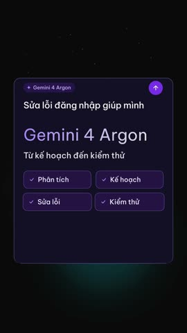
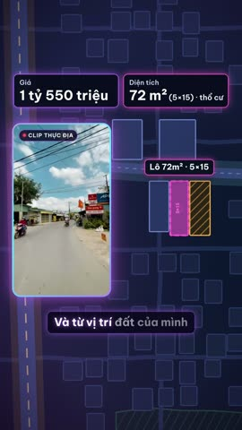
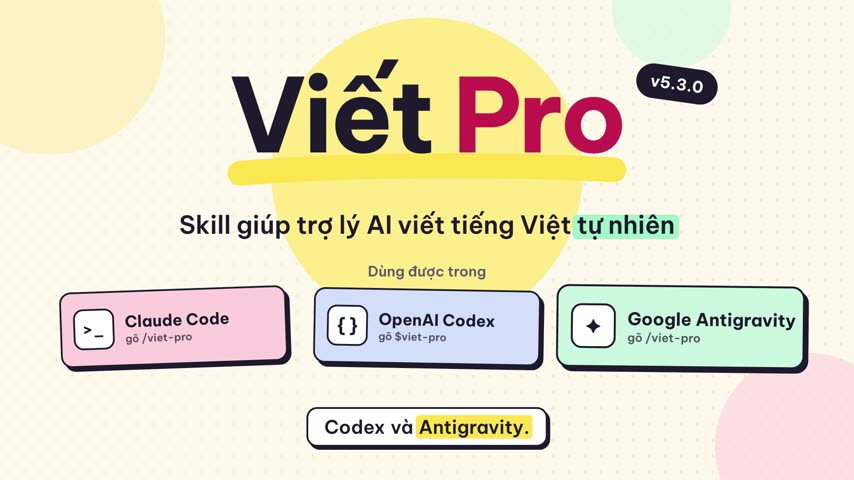

# opus-video

**English** · [Tiếng Việt](README.vi.md)

opus-video is a Claude Code plugin, also usable from OpenAI Codex and Google Antigravity, that turns a topic or brief into a finished Vietnamese video. The agent works with you through a fixed pipeline: brief, suggested example cases, a choice of visual direction, a script that must pass the [viet-pro](https://github.com/abm-dungtq/viet-pro-codex) gate, ElevenLabs voice, sound effects and music, a [HyperFrames](https://hyperframes.dev) build (HTML and GSAP), an animatic you approve, then a delivery render, QA and captions. Output is MP4 in 16:9, 9:16 or 1:1. The plugin never posts to social media for you.

[](https://github.com/abm-dungtq/opus-video/releases/tag/v2.9.0)
[](LICENSE)


[Examples](#examples) · [What it does](#what-it-does) · [Install](#install) · [Skills and routes](#skills-and-the-four-routes) · [Workflow](#the-9-step-workflow) · [viet-pro gate](#the-viet-pro-gate) · [Example cases](#example-case-suggestions) · [AI images and clips](#ai-images-and-clips-through-google-flow) · [Scripts](#key-scripts) · [Lemo-Opuscar styles](#lemo-opuscar-styles) · [Motion Studio](#motion-studio) · [Tests](#tests-and-troubleshooting) · [Credits](#credits-and-licence) · [Contributing](#contributing)

## Examples

These videos were made with opus-video. Click a poster to play the MP4 from the [`demo-videos` release](https://github.com/abm-dungtq/opus-video/releases/tag/demo-videos).

| | | |
|---|---|---|
| [](https://github.com/abm-dungtq/opus-video/releases/download/demo-videos/gemini-argon-9x16.mp4) | [](https://github.com/abm-dungtq/opus-video/releases/download/demo-videos/abm-intro-9x16.mp4) | [](https://github.com/abm-dungtq/opus-video/releases/download/demo-videos/bds-lo-72m2-9x16.mp4) |
| Product launch, 9:16, 15 s | Company intro, 9:16, 30 s | Real-estate listing with the seller's own clip, 9:16 at 720p, 60 s |
| [](https://github.com/abm-dungtq/opus-video/releases/download/demo-videos/viet-pro-intro-16x9.mp4) | [](https://github.com/abm-dungtq/opus-video/releases/download/demo-videos/abm-intro-16x9.mp4) | |
| Explainer for viet-pro, 16:9, 60 s | Company intro, 16:9, 30 s | |

## What it does

- **Start from an example case.** Right after the brief, Jev ranks 1,003 videos made with Claude Opus 5.5 against your brief and shows the three best fits, each with the source post, the reason it was picked and a demo video when one exists. Pick one and the agent copies its prompt and adapts it to your video (see [Example case suggestions](#example-case-suggestions)).
- **You pick the look by eye.** For a new project the agent renders three short styleframes from your own topic in contrasting directions. You choose one, and the script is written afterwards inside that direction's word budget. There are 8 director directions and 64 style profiles, plus two canvas styles from lemo-opuscar (see [Lemo-Opuscar styles](#lemo-opuscar-styles)). A `kinetic-film` style cuts huge words on every beat of a fast track, and its QA fails any hold longer than 0.6 s.
- **Nothing final ships without an approved animatic.** A 540p animatic is rendered for approval, and `render-final.mjs` refuses a delivery render (exit 5) when the plan, the animatic or the approval is missing, or when the animatic barely moves.
- **Measured sync.** Sound effects are checked against the ITU-R BT.1359-1 sync windows, on-screen words against the moment each word is spoken, and music is held 4 to 7 dB under the voice (`mix-balance.mjs`). When normalising to -14 LUFS would push peaks above -1.5 dBTP, `audio-mix` runs a true-peak limiter instead of stopping.
- **Sound.** ElevenLabs voice with word timestamps, sound effects and music. Music can be composed from a section plan, re-cut bar by bar onto your timeline and verified against its source. Cuts can be snapped to the beat and sound effects pinned to a spoken word. Forced alignment gives word timings for a recorded voice. Gemini TTS is an optional voice provider.
- **Real data.** Points of interest come from OpenStreetMap with distance and walking time. Article pages, PDFs and arXiv abstracts are stored word for word under `sources/`, so every on-screen figure can be checked against the original.
- **AI images and clips.** `gflow.mjs` makes Nano Banana images and Veo or Omni Flash clips through Google Flow. Images can carry characters by `@Name` and also save a 2K copy. Clips spend credits, so they run only after you agree (see [AI images and clips through Google Flow](#ai-images-and-clips-through-google-flow)).
- **Real footage (beta).** Cut talking-head or interview clips on silences, or keep the speaker's clip as the spine of a new build.
- **Timeline editing.** A project can carry a `project.json` timeline. Every edit goes through one command gateway, so each change is a version with undo and redo. An MCP server exposes this to agent sessions, and [Motion Studio](#motion-studio) uses it as its interface.

## Install

### Requirements

Node.js 22 or later, git, and ffmpeg with ffprobe. `agy` (Google Antigravity CLI, signed in) is optional and enables the Gemini video review in `judge.mjs`; without it QA uses still frames. `gflow` is optional and needed only for AI images and clips.

### Installer

macOS, Linux, WSL or Git Bash:

```bash
curl -fsSL https://raw.githubusercontent.com/abm-dungtq/opus-video/main/install.sh | bash
```

Windows PowerShell:

```powershell
irm https://raw.githubusercontent.com/abm-dungtq/opus-video/main/install.ps1 | iex
```

The installer puts opus-video, viet-pro v5.6.1 and the HyperFrames CLI and skills in place for each agent it finds, and creates the key file. An older copy is moved to `~/.opus-video-backups/` instead of being deleted. It finishes by running `setup-check`.

To install for chosen agents only (flags combine):

| Flag | Agent | Folder |
|---|---|---|
| `--claude` | Claude Code | `~/.claude/skills/opus-video` |
| `--codex` | OpenAI Codex | `~/.agents/skills/opus-video` |
| `--agy` | Antigravity app/IDE | `~/.gemini/config/skills/opus-video` |
| `--agy-cli` | Antigravity CLI | `~/.gemini/antigravity-cli/skills/opus-video` |
| `--workspace`, `-w` | current project only | `./.claude/skills` and `./.agents/skills` |

Other flags: `--ref <branch-or-tag>` (default `main`), `--with-remotion` (Remotion skills, only for `engine: remotion`), `--skip-deps` (opus-video only, no viet-pro or HyperFrames). Example: `... | bash -s -- --codex --agy`.

### Claude Code as a plugin

Claude Code loads `~/.claude/skills/opus-video` in place as the plugin `opus-video@skills-dir`, so do not also run `claude plugin install` on that machine. If the plugin lives elsewhere, add its folder as a marketplace and install from it:

```bash
claude plugin marketplace add <path-to-opus-video>
claude plugin install opus-video@opus-video-private
```

### Windows

`install.ps1` takes `-Hosts claude,codex,agy,agy-cli`, `-Ref`, `-WithRemotion` and `-SkipDeps`. It installs viet-pro with `git clone` of the viet-pro-codex release tag, because viet-pro has no PowerShell installer. The PowerShell installer has not yet been run on a real Windows machine; if it fails, follow the manual install in the [agent install guide](docs/cai-dat-agent.md) (in Vietnamese). Under WSL, install and run the agent inside WSL.

### Keys

Fill in `~/.config/opus-video/.env` (Windows: `%USERPROFILE%\.config\opus-video\.env`):

```
ELEVENLABS_API_KEY=...
OPUS_VIDEO_VOICE_ID=...
# optional: TypeSafe Jev ranks reference cases and lemo styles, and audits scripts
TYPESAFE_API_KEY=...
# optional: only for the Gemini voice provider
GEMINI_API_KEY=...
```

Keep the file readable only by you (`chmod 600`). Scripts read it and never print a key.

### Check the machine

```bash
node ~/.claude/skills/opus-video/scripts/setup-check.mjs
node ~/.claude/skills/opus-video/scripts/eleven.mjs doctor
```

`setup-check` prints `READY` or, for each missing item, the command that fixes it. It requires Node 22+, git, ffmpeg, ffprobe, the `hyperframes` CLI 0.8.192 or later, viet-pro with its self-test, the HyperFrames skills, `ELEVENLABS_API_KEY` and `OPUS_VIDEO_VOICE_ID`. `agy`, `TYPESAFE_API_KEY` and Remotion only produce warnings. Add `--json` for machine output.

### Make a video

Open a new agent session and describe the video, for example "make a 30-second intro for <product>, in 16:9 and 9:16".

- Claude Code picks the `opus-video` skill on its own. You can also call it from the slash menu, where plugin skills appear under the `opus-video:` namespace.
- Codex: `$opus-video <request>`.
- Antigravity: `/opus-video <request>`, or "use the opus-video skill to ...".
- Any other agent: "Read `<opus-video>/skills/opus-video/SKILL.md` and follow it to ...".

## Skills and the four routes

The plugin has 11 skills. `opus-video` is the entry point; it picks a route and calls the `ov-*` skills in order.

| Skill | Job |
|---|---|
| `opus-video` | Entry point: chooses the route, holds the shared rules and gates |
| `ov-setup` | Step 0: `setup-check`, `eleven.mjs doctor`, keys, `gflow.mjs doctor` when AI images are needed |
| `ov-brief` | Step 1: minimal `BRIEF.md`, brand kit |
| `ov-cases` | Suggests three example cases right after the brief and copies the chosen case's prompt into `build/TEMPLATE.md`; the quick route from one case |
| `ov-direction` | Step 1b: three styleframes, chosen direction and style; lemo-opuscar suggestions only for 3D, product or music-led videos |
| `ov-script` | Step 2: full viet-pro gate, source checking |
| `ov-audio` | Step 5: voice, SFX, music, beat grid, timing, mix |
| `ov-build` | Steps 3 to 7: storyboard, engine, `PLAN.md`, build, AI images and clips, animatic, draft render |
| `ov-footage` | Real footage, or the speaker's clip as the spine |
| `ov-deliver` | Steps 7 to 9: delivery render, QA, captions, export |
| `ov-studio` | `project.json`, the command gateway, importing old projects, Motion Studio |

Two agents live in `agents/`: `ov-director` (read-only; writes per-scene direction and reviews contact sheets) and `ov-executor` (runs the pipeline from the agreed direction). Say `--poor` or "tiết kiệm" to run everything in one session with one review round; no gate is skipped. Details are in [references/dao-dien-va-thi-cong.md](references/dao-dien-va-thi-cong.md).

| Route | When you say | Skill chain |
|---|---|---|
| `dao-dien` (director, default) | "make a video", "explainer", "ad" | setup → brief → case suggestions → direction → script → audio → build → deliver |
| `nhanh` (quick, from a case) | "quickly", "from a template", "like this video" | setup → brief → case suggestions → pick one case → script → audio → build → deliver |
| `tu-nhac` (from music or footage) | "from this song", "on the beat", "from my clip" | setup → brief → case suggestions → audio (beat grid first) or footage → direction → script → build → deliver |
| `timeline` (edit an existing project) | "edit the video", "open studio", "change a shot" | studio → gateway edits → audio (changed lines only) → deliver |

Every route keeps the viet-pro gate and the delivery gates of `render-final.mjs`. The quick route only replaces the three styleframes with the case you picked.

## The 9-step workflow

| Step | What happens | Skill |
|---|---|---|
| 0 | Check tools, skills and keys | `ov-setup` |
| 1 | Minimal brief, then three suggested example cases | `ov-brief`, `ov-cases` |
| 1b | Three styleframes, you choose the direction (lemo-opuscar suggestions when relevant) | `ov-direction` |
| 2 | Script through the viet-pro gate | `ov-script` |
| 3, 4, 4b | Storyboard, engine, `PLAN.md` and the plan gate | `ov-build` |
| 5 | Voice, SFX, music, timing, mix | `ov-audio` |
| 6, 6b | Build the scenes, then the animatic you approve | `ov-build` |
| 7 | Delivery render through `render-final.mjs` | `ov-deliver` |
| 8 | QA: `qc-mp4`, `word-sync`, `video-lint`, optional `judge` | `ov-deliver` |
| 9 | Captions, hand-off and per-platform export | `ov-deliver` |

On the director route the order is 0, 1, 1b, 2, 3, 4, 4b, 5, 6, 6b, 7, 8, 9. Four gates cannot be skipped: the direction you chose by eye, the viet-pro script, `PLAN.md`, and the approved animatic. A project folder ends up holding `BRIEF.md`, `CASES.md`, `STORYBOARD.md`, the script table, `PLAN.md`, `DEMO.md`, `QA.md`, `CAPTIONS.md`, `assets/` and `renders/`.

## The viet-pro gate

Every Vietnamese spoken line, on-screen word and caption goes through the [viet-pro](https://github.com/abm-dungtq/viet-pro-codex) workflow before voice or render: a three-column script table, a Humanizer pass with notes, lint, and a `## viet_pro` record in the project. Then:

```bash
node <opus-video>/scripts/check-viet-pro.mjs --project .                     # before voice (stage script)
node <opus-video>/scripts/check-viet-pro.mjs --project . --stage delivery    # before hand-off
```

The check exits 0 on pass and 1 when the gate fails. `eleven.mjs` runs the same gate before it generates or aligns a voice and exits 4 while it fails. Change a spoken line later and the gate must pass again before that line is re-voiced. The procedure is in [references/script-workflow.md](references/script-workflow.md).

## Example case suggestions

The case corpus holds 1,003 videos made with Claude Opus 5.5, taken from two MIT-licensed lists; 718 of them have a watchable demo video. For every new video the agent rewrites the brief as `BRIEF.case-query.json` (English JSON) and runs:

```bash
node <opus-video>/scripts/rerank-cases.mjs --suggest --project .
node <opus-video>/scripts/case-template.mjs --project . --case <id> [--reference]
node <opus-video>/scripts/case-template.mjs --project . --show
```

`--suggest` asks Jev to rank the whole corpus by video type, subject and style, drops cases that repeat the same post, and prints three cases with a link, a one-line description, the reason and a `Video demo:` line when there is one. The result is written to `CASES.md`, with `case_search:` and `case_refs:` in `BRIEF.md`. An off-subject case ranks below every on-subject case, however well its type and style fit. When Jev fails or the key is missing, the first line of the suggestion block says so.

When you pick a case, `case-template.mjs` writes `build/TEMPLATE.md`: the demo video, the source post, the prompt page in the repository (pinned to a commit), Jev's reason, and two sections the agent writes: why this prompt fits, and the prompt adapted to your video. `--show` prints that block for you, and exits 3 while a section is still a placeholder. The `dao-dien` and `tu-nhac` routes use `--reference`, which takes the case as a reference only.

New briefs carry `brief_version: 3`. Without `case_search:` or `CASES.md`, `make-pitch.mjs init` exits 6 and `check-preflight` fails. A `brief_version: 2` project only gets a warning.

## AI images and clips through Google Flow

`gflow.mjs` calls [gflow-studio](https://github.com/abm-dungtq/gflow-studio), the abm-dungtq edition of gflow-cli, to make Nano Banana images and Veo or Omni Flash clips. Install it once and sign in to Google Flow in a Chrome window:

```bash
uv tool install "git+https://github.com/abm-dungtq/gflow-studio.git@main"
uvx --from "git+https://github.com/abm-dungtq/gflow-studio.git@main" playwright install chromium
gflow auth login --browser chrome --profile <name>
node <opus-video>/scripts/gflow.mjs doctor
```

```bash
node <opus-video>/scripts/gflow.mjs image --prompt-file prompts/k1.txt --out assets/gen/k1.png [--ref a.png] [--cast series/cast.json] [--upscale]
node <opus-video>/scripts/gflow.mjs video --start assets/gen/k1.png --prompt-file prompts/c1.txt --out assets/gen/c1.mp4 --spend [--upscale]
```

- Images cost no credits. With `--ref` the command runs `i2i`; without it, `t2i`.
- `--cast` reads a character file (name → approved image, `null` while pending). Each `@Name` in the prompt is attached to that character's image; names that could not be attached are printed.
- `image --upscale` also saves a free 2K copy next to each image, named `<name>.2k.<ext>`; the 1K image is kept because the upscale redraws small details. It needs a gflow-studio build with `image --upscale` (currently on the `an-trinh-duyet` branch); with an older build the command stops before sending anything to Flow.
- `video` spends Flow credits, so it refuses to run without `--spend`. `video --upscale` replaces the 720p clip with a free 1080p export.
- Every run goes into one named Flow project (the project folder name by default) and is written to `assets/gen/gflow-ledger.jsonl` before and after it runs. The command never resubmits a failed run on its own.

## Key scripts

All scripts live in `scripts/`, import only Node built-ins, and print their usage, flags and exit codes with `--help`.

| Area | Scripts |
|---|---|
| Setup | `setup-check.mjs`, `skill-paths.mjs` |
| Example cases | `rerank-cases.mjs` (`--suggest`), `case-template.mjs`, `find-cases.mjs` |
| Direction | `make-pitch.mjs` (`init`, `render`, `choose`), `directions.mjs`, `styles.mjs`, `lemo-pick.mjs`, `lemo.mjs`, `brand.mjs` |
| Script and sources | `check-viet-pro.mjs`, `voice-gate.mjs`, `source-ingest.mjs`, `poi-fetch.mjs` |
| Sound | `eleven.mjs` (`doctor`, `tts`, `sfx`, `music`, `align`, `audio-meta`), `beat-grid.mjs`, `arrange-music.mjs`, `verify-arrangement.mjs`, `audio-mix.mjs`, `mix-balance.mjs` |
| AI images and clips | `gflow.mjs` (`doctor`, `image`, `video`) |
| Build | `composition.mjs` (`init`, `add-part`), `timing.mjs`, `recipe-pack.mjs`, `beat-fit.mjs`, `cues.mjs`, `reframe.mjs` |
| Gates and QA | `check-preflight.mjs` (`--stage plan`, `--stage final`), `make-demo.mjs`, `sfx-sync.mjs`, `word-sync.mjs`, `qc-mp4.mjs`, `video-lint.mjs`, `judge.mjs` |
| Delivery | `render-final.mjs`, `captions-from-transcript.mjs`, `export.mjs` |
| Timeline | `gateway.mjs` (`patch`, `undo`, `redo`, `log`, `show`, `derive`), `manifest-import.mjs`, `studio.mjs` |
| Footage | `cut.mjs` (`probe`, `apply-edl`) |
| Jev quality | `jev-eval.mjs`, `jev-audit-eval.mjs` |

Longer guides, in Vietnamese: [introduction](docs/gioi-thieu.md), [agent install guide](docs/cai-dat-agent.md), [in-depth guide](docs/huong-dan-chuyen-sau.md), [prompt library](docs/thu-vien-prompt/README.md). Release notes are in [CHANGELOG.md](CHANGELOG.md).

## Lemo-Opuscar styles

[lemo-opuscar](https://github.com/lemomo-ai/lemo-opuscar) by LemoLab is a library of film styles written in code. At the commit opus-video pins (in `data/lemo/styles.json`) it has 59 styles; you can browse them in its [gallery](https://lemomo-ai.github.io/lemo-opuscar/). Motion Studio fetches this same commit. At step 1b, `ov-direction` suggests two or three of them before the styleframes, but only for 3D, product or music-led videos, or when you ask for lemo; voiced Vietnamese explainers go straight to the style profiles.

```bash
node <opus-video>/scripts/lemo.mjs fetch     # once per machine, needs network
node <opus-video>/scripts/lemo-pick.mjs rank --brief-json BRIEF.case-query.json --limit 3 --stats
node <opus-video>/scripts/lemo-pick.mjs choose --project . --style <slug> --search "<lemo_search>"
```

- `fetch` adds each style's `style.json` and `STYLE.md` to the local cache. `rank` reads them; `--library <dir>` points at another checkout, such as Motion Studio's cache.
- With `TYPESAFE_API_KEY` set, Jev scores every style from 0 to 4 in one request, judging whether the style's look, typical uses and tone suit the brief. Ties are broken by keyword matches.
- Without a key, or when the Jev call fails (HTTP error, timeout, bad reply), `rank` falls back to keyword order and still exits 0: brief words found in the style's uses count three times, in its name and group twice, and in its film line and the opening of `STYLE.md` once. A failed call prints one line on stderr.
- Each result gives a Vietnamese reason and says whether the style is a canvas layer that `lemo.mjs add` can draw, or one to build from its `STYLE.md` grammar. `--stats` prints the `lemo_search` value for the brief.
- `choose` records the pick in the front matter of `BRIEF.md`: `lemo_style: <slug>` for a canvas-layer style (today `watercolor` and `glass-product`), or `lemo_ref: <slug>` for a grammar-only style. It also writes `lemo_search:` (`jev` or `keyword (<reason>)`) and adds one LemoLab credit line to `assets/CREDITS.md`.
- For a canvas-layer style, `lemo.mjs add --project . --style <slug>` copies the engine into the project and draws it under the HyperFrames composition. Vietnamese text stays in the HTML layer. The layer is drawn for 16:9; a vertical edition needs its own scene.

The scene contract, licences and render measurements are in [references/lemo-canvas.md](references/lemo-canvas.md).

## Motion Studio

[Motion Studio](https://github.com/abm-dungtq/motion-studio) is a separate web app that runs on your machine. You create projects, hand work to an AI director with approval cards, edit a timeline, and export MP4s or layered projects for CapCut, Final Cut Pro, Premiere and DaVinci Resolve. opus-video is its provider. The `studio.mjs` script in this plugin is a shim that finds Studio through `MOTION_STUDIO_HOME` and runs it:

```bash
node <opus-video>/scripts/studio.mjs start --background   # http://127.0.0.1:4317
node <opus-video>/scripts/studio.mjs status
node <opus-video>/scripts/studio.mjs stop
```

Studio reaches the plugin only through `scripts/studio-api.mjs`, which exports `STUDIO_API = 4`, the plugin version and the commands Studio uses, including case suggestions. The compatibility table lives in the Motion Studio README.

## Tests and troubleshooting

```bash
node --test "<opus-video>/scripts/tests/*.test.mjs"
```

Keep the quotes so Node expands the glob. A few tests use a real project; point them at yours with `OPUS_VIDEO_SMOKE_DIR` and `OPUS_VIDEO_ABM_DIR`.

To measure the Jev model itself, run `node <opus-video>/scripts/jev-eval.mjs` with a key. It scores the case rerank (single and composite), lemo-pick, the script audit and Motion Studio's suggestions against gold sets you approved, prints a table of baseline, now, no-Jev and status, and exits 1 when a score dropped. A full run costs about 0.10 USD. `.agentkit/test-impact.json` lets `ak test optimize --base origin/main` pick the offline Jev tests when Jev files change. See [references/jev-eval.md](references/jev-eval.md) (Vietnamese).

| Symptom | Fix |
|---|---|
| `setup-check` reports a skill not installed | `npx hyperframes skills`, then open a new agent session |
| viet-pro self-test failed | Reinstall viet-pro |
| `eleven.mjs` exits 4 | The script gate is failing: run `check-viet-pro.mjs --project .` and fix the FAIL lines |
| `make-pitch.mjs init` exits 6 | No case suggestion yet: run `rerank-cases.mjs --suggest --project .` |
| `render-final.mjs` exits 5 | Plan, animatic or approval missing: run `check-preflight.mjs --project . --stage final` |
| `lemo-pick.mjs` exits 4 | The style library is missing: run `lemo.mjs fetch` |
| `gflow.mjs` exits 23 | Flow changed its interface: run `gflow update`, then ask the user before generating again |
| Windows cannot find `ffmpeg` after install | Open a new terminal |

To uninstall, delete the `opus-video` folder from each agent's skill folder, and `~/.config/opus-video/` if you no longer need the keys.

## Credits and licence

opus-video is MIT-licensed ([LICENSE](LICENSE)). Third-party material is listed in [NOTICE](NOTICE), with licences under `third_party/`:

- `scripts/cut.mjs` adapts ideas from [open-edit](https://github.com/veedstudio/open-edit) (Apache-2.0, VEED LIMITED).
- Style profiles, the composition skeleton, motion principles, the beat-grid, reframe and style-resolution algorithms, music arrangement, beat-fit, cues, karaoke captions, the voice envelope and the director and executor roles adapt the motion-video skill of AgentKit (MIT, BestAgentKits).
- The two lemo style profiles and `templates/lemo/` adapt [lemo-opuscar](https://github.com/lemomo-ai/lemo-opuscar) by LemoLab (code MIT, demo films CC BY 4.0). `lemo.mjs` copies its engines and three.js (MIT) into your project with their licences, and `lemo-pick.mjs` reads its style files from the local cache; this repository redistributes neither.
- The `kinetic-film` style learns its grammar from fast kinetic-type films, including Scenario's scenario-kinetic-film skill; no code or text from that skill is included.
- `third_party/hyperframes-skills/` is an unchanged copy of files from HyperFrames v0.8.184 skills (Apache-2.0).
- The reference cases in `data/` come from two MIT-licensed lists. Each prompt belongs to its author, every row links to it, and source videos are not redistributed. Sources and commits are in [data/SOURCES.md](data/SOURCES.md).

## Contributing

Bug reports and pull requests are welcome at [github.com/abm-dungtq/opus-video](https://github.com/abm-dungtq/opus-video/issues).

- Run the full test suite above before opening a pull request, and add tests for changed behaviour.
- Add a line under `## Unreleased` in [CHANGELOG.md](CHANGELOG.md) for anything a user or Motion Studio would notice.
- Use conventional commit messages (`feat:`, `fix:`, `docs:` ...).
- Keep scripts on Node built-ins and give every new CLI a `--help` block.
- Do not edit the `hyperframes*`, `media-use` or `viet-pro` skills from here; they are updated from upstream.
- Keep [NOTICE](NOTICE) and `third_party/` in step with any adapted material.
- Never commit keys, `.env` files or rendered media.
